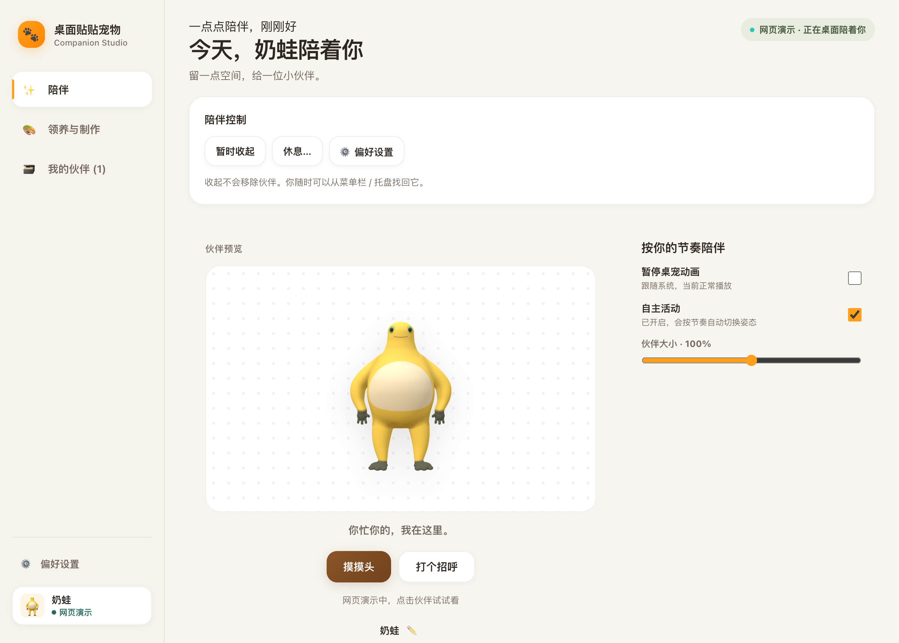
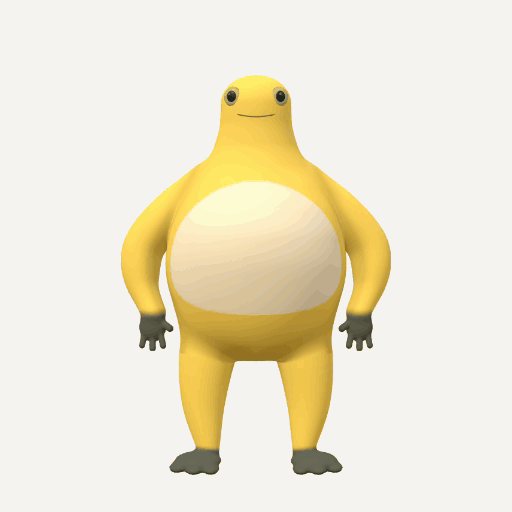
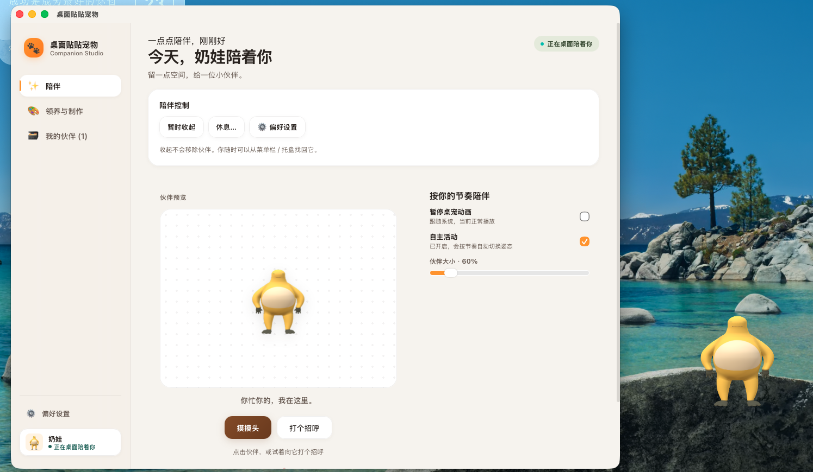

# 桌面贴贴宠物

一个 Linux / macOS 桌面宠物应用原型。它用 Tauri + React 提供管理界面，用 Rust 创建透明置顶的原生桌面宠物窗口：Linux 使用 GTK，macOS 使用 AppKit，让本地动作帧包里的猫猫狗狗在桌面上活动。

当前版本的核心路线是“导入本地动作帧包并播放”，不依赖在线 AI 服务也能运行；同时提供 AI 生成页签，可走“上传宠物照片 -> 生成角色设定图 -> 生成 6 组动作帧 -> 自动导入桌面宠物”的完整链路。

## 功能特性

- 首次领养引导：选择内置伙伴“咕唧”、起名并入住，支持跳过教学；老用户和主动清空用户不会被强制重走。
- 陪伴主页：以伙伴为中心展示真实状态，提供摸摸头、打个招呼、暂时收起、休息一小时和立即唤回。
- 统一原生状态：主界面、托盘和右键菜单读取同一份 `sessionId / revision` 快照；显示、动画暂停、自主活动和比例不再维护两套勾选。
- 偏好设置抽屉：暂停动画、自主活动、比例、透明区域穿透、开机自启、减少动态效果和能力说明；不支持的系统能力不显示空操作。
- 错误恢复：素材缺失、原生窗口失败、设置保存失败和自启失败保留已有资料，提供重试、选择已有伙伴或打开制作入口。
- 本地导入 6 组动作帧：待机、坐下、睡觉、开心、走路、跳跃。
- 支持 PNG、JPG、WebP 帧图，透明 PNG 效果最佳。
- 手动上传的帧包会写入应用数据目录，并同步到原生桌面宠物。
- macOS 使用 ImageIO 缩略图 + CALayer 合成，抑制 App Nap，并支持一键重置宠物位置。
- 宠物会自主切换待机、走路、坐下、睡觉、开心；用户操作会打断并进入冷却。
- macOS：单击宠物触发开心反馈，拖拽移动窗口。
- macOS：透明区域默认点击穿透，可通过托盘菜单关闭。
- 托盘菜单支持切换动作、暂停自主行为/动画、透明区域穿透、重置位置和开机自启。
- AI 生成页签：照片 + Minimax API Key + 上传服务，生成角色设定图和 6 组动作帧；默认用 3×2 动作序列图提升连贯性，支持本地自动去背景并自动导入。
- 管理界面可预览动画、切换动作、调整宠物缩放比例；“更多动作与预览工具”折叠保留六动作和逐帧预览，并明确只影响页面预览。
- 网页模式明确标注“网页演示”，不声称控制真实桌面；桌面能力按实际运行结果显示。
- 原生桌面宠物窗口透明、置顶、可拖拽（Linux GTK / macOS AppKit）。
- 宠物窗口右键菜单可直接切换动作。
- 关闭管理界面后，宠物窗口继续运行。
- 系统托盘支持重新打开管理界面和退出应用。
- 宠物配置、领养引导记录和收藏保存到 IndexedDB；原生显示意图、休息到期时刻、比例和动态偏好保存到 `native-pet-settings.json`（schema v2）。
- 首版验证：105 项前端单元测试、33 项 Rust 测试、51 个隔离浏览器流程和 TypeScript/Vite 生产构建通过；四轮复核的 16 项问题已修复并补回归；真实 macOS / Linux 桌面验收仍待完成。
- v0.3 C00（`e996997`）：领养进度按 `intentId / progressRevision` 条件写入，激活返回明确的显示结果，显示重试携带选择版本与原生目标校验；118 项前端单元测试、36 项 Rust 测试、58 个隔离浏览器流程和生产构建通过。
- v0.3 C01（`5436b22`）：核心操作栏移到预览前并在内容区吸顶，840×620 三种显示状态首屏可操作；紧凑预览 220px、40px 点击目标、长名字与 200% 等效宽度无横向滚动。62 个隔离浏览器流程通过。
- v0.3 C02（`46b110e`）：伙伴架当前卡片按真实状态提供回到陪伴、唤回、提前唤回、重试显示、恢复素材和恢复伙伴；原生目标不一致显示“需要恢复”，素材恢复保留隐藏/休息意图，位置找回不唤醒隐藏伙伴。67 个隔离浏览器流程通过。
- v0.3 C03（`f08e7f2`）：15/30/60 分钟非模态休息面板、托盘三个时长、保持收起；Rust 校验时长并保留旧一小时调用；暂停与自主活动说明按实际原因展示，剩余时间按分钟刷新。71 个隔离浏览器流程、123 项前端单元测试、38 项 Rust 测试通过。
- v0.3 C04（`a970ef3`）：工坊改为领养/导入/装配/照片四张任务卡，空伙伴架导入与伙伴架制作新宠物直达任务；任务、帧检视和表单输入跨页面保留，长任务切页继续；素材恢复只更新既有伙伴。77 个隔离浏览器流程通过。
- v0.3 C05（`6ab5348`）：数据库升级 v3，移除改为写入最近移除；当前卡片提前说明接替者，提供至少 10 秒可暂停的撤销提示和跨重启恢复；旧记录、迟到写入和多窗口恢复不会重复或复活资料。87 个隔离浏览器流程、136 项前端单元测试、38 项 Rust 测试通过。C06 真实桌面验收仍待完成。

## 首版体验

1. 首次启动进入三步引导：选择咕唧 → 起名或直接使用默认名 → 见面并试一次互动。领养提交使用稳定 `adoptionId / pendingPetId`，并在单事务内领取和复核；双击、双窗口、刷新或提交失败不会产生两条记录。
2. 日常在“陪伴”页查看真实状态；摸摸头播放 happy，打个招呼播放 jump，同一伙伴全入口共享 1.5 秒冷却。
3. “暂时收起”保持隐藏直到显式唤回；“休息一小时”保存到期时刻，到期后只恢复当前健康的伙伴。唤回从当前动作首帧开始，显式暂停和自主活动偏好保留。
4. 偏好设置与托盘同步；设置保存失败时勾选回到已确认值，并在页面上保留可重试的恢复入口。
5. “领养与制作”页先展示现成伙伴，高级制作折叠保留本地导入、动作帧装配和照片定制。

## 技术栈

- Tauri 2
- React 19
- Vite
- TypeScript
- Rust
- GTK 3 / GDK Pixbuf（Linux）
- AppKit / objc2 / ImageIO / CALayer（macOS）
- Tauri tray icon

## 平台支持

当前支持 Linux 和 macOS：

- Linux：GTK 原生宠物窗口。
- macOS：AppKit `NSPanel` 原生宠物窗口（透明、置顶、非激活、可拖拽）。
- Windows：暂未实现原生宠物窗口。

管理界面基于 Tauri + React，跨平台；桌面宠物窗口按平台原生实现。技术取舍记录见：

```text
docs/adr/0001-native-pet-window-per-platform.md
docs/adr/0002-macos-native-pet-window.md
```

## 运行效果

以下素材由仓库当前代码实拍生成；前两张为浏览器预览模式（使用代码内置的模拟帧包），macOS 截图为 AppKit 原生透明宠物窗口的真机效果。





macOS 原生宠物窗口（AppKit `NSPanel`，透明置顶，浮在管理界面之上）：



## 快速开始

### 1. 安装依赖

```bash
npm install
```

Debian / Ubuntu 系统依赖可参考：

```bash
sudo apt update
sudo apt install -y \
  build-essential \
  curl \
  wget \
  file \
  libssl-dev \
  libgtk-3-dev \
  libwebkit2gtk-4.1-dev \
  libayatana-appindicator3-dev \
  librsvg2-dev
```

macOS 需要 Xcode Command Line Tools 和 Rust：

```bash
xcode-select --install
curl --proto '=https' --tlsv1.2 -sSf https://sh.rustup.rs | sh
```

macOS 不再依赖 GTK；Rust 依赖会按目标平台自动选择。

### 2. 准备动作帧包

应用默认读取：

```text
./frame-pack
```

也可以在界面中手动修改帧包目录。

帧包目录结构：

```text
frame-slicer/
  idle/
    000.png
    001.png
    002.png
    003.png
    004.png
  sit/
  sleep/
  happy/
  walk/
  jump/
```

要求：

- 必须包含 `idle`、`sit`、`sleep`、`happy`、`walk`、`jump` 六个目录。
- 每个动作目录至少 5 张图片。
- 支持 `png`、`jpg`、`jpeg`、`webp`。
- 文件名按字典序排序，建议使用 `000.png`、`001.png` 这种编号。

### 3. 开发运行

```bash
npm run tauri:dev
```

开发模式会启动 Vite dev server，并让 Tauri 连接：

```text
http://localhost:1420
```

如果直接运行开发模式二进制但没有启动 Vite，可能看到：

```text
Could not connect to localhost: Connection refused
```

这种情况请使用 `npm run tauri:dev`，或者运行正式构建产物。

### 4. 正式构建

```bash
npm run tauri:build
```

构建产物（Linux）：

```text
src-tauri/target/release/pet_desktop_tauri
src-tauri/target/release/bundle/deb/桌面贴贴宠物_0.1.0_amd64.deb
```

构建产物（macOS）：

```text
src-tauri/target/release/bundle/macos/桌面贴贴宠物.app
src-tauri/target/release/bundle/dmg/桌面贴贴宠物_0.1.0_aarch64.dmg
```

DMG 需要 `hdiutil` 和 Finder 自动化权限；如果只想本地运行，直接使用 `.app` 即可。

Universal（Apple Silicon + Intel）：

```bash
rustup target add aarch64-apple-darwin x86_64-apple-darwin
npm run tauri:build:universal
```

签名、公证和 CI 发布流程见 [docs/release-macos.md](./docs/release-macos.md)。

运行二进制：

```bash
./src-tauri/target/release/pet_desktop_tauri
```

安装 deb：

```bash
sudo apt install "./src-tauri/target/release/bundle/deb/桌面贴贴宠物_0.1.0_amd64.deb"
```

不要用 `cargo build --release` 作为最终应用构建命令。它可能不会完整执行 Tauri 的前端资源嵌入流程，导致应用运行后仍尝试连接 `localhost:1420`。

## 操作说明

- 点击“预置帧包”页签，填写本地帧包目录。
- 点击“一键导入并保存预置帧包”。
- 或在“手动上传”页签上传 6 组帧，点击“保存并同步到桌面”；桌面版会把帧包写入应用数据目录。
- 或在“AI 生成”页签填写 Minimax API Key、参考图上传服务和宠物照片，点击“开始生成”。
- 在管理界面右侧预览动画并切换动作。
- 拖拽桌面宠物窗口可以移动位置。
- 右键桌面宠物窗口可以切换动作。
- 管理界面“动作控制”下方可点击“重置位置”，把宠物移回主屏右下角。
- 关闭管理界面不会退出应用，宠物会继续留在桌面。
- 从系统托盘可以切换 6 个动作、暂停自主行为、暂停动画、重置位置、开关开机自启；macOS 还可开关透明区域穿透。
- 从系统托盘选择“打开主界面”可以恢复管理界面。
- 从系统托盘选择“退出应用”才会完全退出。

## 项目架构

```text
pet-desktop-tauri/
  src/                 React 管理界面
  src-tauri/           Tauri / Rust 桌面能力
  tools/               辅助工具脚本
  package.json         前端依赖和 npm 脚本
  src-tauri/Cargo.toml Rust 依赖和 crate 配置
```

运行时结构：

```text
React 管理界面
-> Tauri command
-> Rust 后端读取帧包、控制原生窗口
-> GTK 透明置顶窗口播放桌面宠物
```

## 关键文件

| 文件 | 作用 |
| --- | --- |
| `src/main.tsx` | React 主入口，包含管理界面、帧包导入、动画预览、动作切换和缩放控制。 |
| `src/styles.css` | 管理界面和宠物窗口样式。 |
| `src/types.ts` | 宠物类型、动作枚举、帧集合类型和存储 key。 |
| `src/storage.ts` | IndexedDB 持久化、BroadcastChannel 同步、动作切换同步。 |
| `src/ai-generation.ts` | 照片上传、角色设定图与 30 帧动作生成、帧包落盘。 |
| `src/prompt-builder.ts` | 适配 Minimax 1500 字符限制的压缩 prompt 构建。 |
| `src/sprite-sheet.ts` | 3×2 动作序列图的切分与帧提取。 |
| `src/background-removal.ts` | 绿幕/纯色背景的本地 alpha 抠图与边缘处理。 |
| `src-tauri/src/lib.rs` | Tauri 主逻辑，注册命令、启动原生宠物窗口、托盘菜单、窗口关闭拦截、Minimax/上传命令。 |
| `src-tauri/src/native_pet/mod.rs` | 共享运行时状态、设置与帧包 API、平台分发。 |
| `src-tauri/src/native_pet/linux.rs` | Linux GTK 宠物窗口。 |
| `src-tauri/src/native_pet/macos.rs` | macOS AppKit `NSPanel` 宠物窗口。 |
| `src-tauri/src/native_pet/settings.rs` | 统一设置结构与原子写入。 |
| `src-tauri/src/native_pet/frame_pack.rs` | 帧包扫描、校验与 data URL 编码。 |
| `src-tauri/src/autostart.rs` | 开机自启（macOS LaunchAgent / Linux autostart）。 |
| `src-tauri/tauri.conf.json` | Tauri 应用窗口、构建和打包配置。 |
| `src-tauri/capabilities/default.json` | Tauri 权限配置。 |
| `prompts/` | AI 角色原型图和动作帧生成的 prompt 模板。 |
| `tools/frames/generate.py` | 动作帧的确定性变形/接地脚本，保证头部刚性、出血边距和脚底锚点。 |
| `tools/upload-server.mjs` | 参考图上传服务示例，用于 Minimax 图生图公网 URL。 |
| `tools/nginx-upload-static.conf` | 上传服务的 nginx 配置示例。 |

## 数据流

导入帧包：

```text
本地帧包目录
-> load_preset_frame_pack
-> Rust 读取 idle/sit/sleep/happy/walk/jump
-> 前端保存 PetProfile 到 IndexedDB
-> 通知 BroadcastChannel
-> 原生宠物窗口读取同一帧包目录并播放
```

手动上传：

```text
本地图片
-> FileReader 转 data URL
-> save_manual_frame_pack
-> 写入应用数据目录 manual-frame-packs/<pack>
-> set_native_pet_frame_root
-> 原生宠物窗口读取并播放
```

动作切换：

```text
管理界面按钮 / 宠物右键菜单
-> setCurrentAction
-> 更新 IndexedDB
-> 调用 set_native_pet_action
-> 原生宠物窗口切换动作
```

窗口关闭：

```text
点击管理界面关闭按钮
-> Tauri CloseRequested
-> prevent_close
-> hide studio 窗口
-> 应用进程继续运行
-> 桌面宠物继续存在
```

## AI 生成链路

桌面版“AI 生成”页签使用以下链路：

```text
宠物照片
-> upload_reference_image 上传为公网 URL
-> generate_minimax_image 生成角色设定图
-> 上传角色设定图作为动作帧参考
-> 默认每个动作生成 1 张 3×2 序列图（共 6 次请求），切分为 5 帧
-> 或切换到逐帧模式，逐动作生成 30 帧
-> 本地按绿幕/边缘纯色去除背景，生成透明 PNG
-> save_manual_frame_pack 写入应用数据目录
-> set_native_pet_frame_root 同步桌面宠物
```

要求：

- Minimax API Key（只保存在当前会话，不写入磁盘）。
- 可公网访问的参考图上传服务，例如：

```bash
PUBLIC_BASE_URL="https://your-domain.example" node tools/upload-server.mjs
```

- `image-01` 的 prompt 上限是 1500 字符，运行时使用 [src/prompt-builder.ts](src/prompt-builder.ts) 的压缩 prompt；`prompts/` 中的完整模板仍用于 ChatGPT 合成和人工调优。
- 默认序列图模式约 7 次图像请求（1 张角色设定 + 6 张序列图），逐帧模式约 31 次；耗时可能数分钟，可随时取消。
- AI 页签提供“测试 API Key（1 次）”按钮，可先验证 Minimax 连接。
- 自动去背景默认开启，可在页签中关闭；它是本地颜色抠图，复杂边缘或背景不纯时可能残留。

AI 角色原型图和动作帧 prompt 模板保存在 `prompts/`。这些模板只保存通用结构和可复用描述，真实生成记录建议放在本地 `generation-runs/`，不要提交 API Key、私有图片 URL、用户原图或未脱敏生成参数。

上传服务示例：

```bash
mkdir -p /opt/pet-upload
cd /opt/pet-upload
PUBLIC_BASE_URL="https://your-domain.example" node /path/to/upload-server.mjs
```

上传接口接收：

```json
{
  "filename": "pet-reference.png",
  "content_type": "image/png",
  "base64": "..."
}
```

返回：

```json
{
  "url": "https://your-domain.example/uploads/pet-reference.png"
}
```

不要把 API Key、token、cookie 或任何私密配置提交到仓库。

## 当前限制

- AI 生成依赖 Minimax API Key 和公网上传服务，未接入本地模型。
- 自动去背景是本地颜色抠图，不是分割模型；发丝、半透明边缘或非纯色背景可能残留，必要时请手动抠图。
- 序列图模式依赖模型按 3×2 网格输出；如果格子错位或数量不足，可切换到逐帧模式。
- 每个动作的 5 帧是独立请求，动作连贯性受模型影响，可能需要人工筛选或替换。
- 默认帧包目录是相对工作目录的 `./frame-pack`，只用于开发；打包时帧包会作为资源写进 app bundle（macOS 在 `Contents/Resources/frame-pack`），运行时找不到相对目录会自动回退到它。想换自己的帧包，在界面里填绝对路径即可。
- 手动上传的帧包会复制到应用数据目录，不会修改原始图片。
- macOS 已持久化桌面宠物窗口位置；Linux 暂未持久化窗口位置。
- 点击穿透与单击反馈目前仅 macOS 实现；Linux 仍为整窗拖拽、右键菜单。
- Windows 需要后续补充原生宠物窗口实现；开机自启目前支持 macOS（LaunchAgent）和 Linux（autostart .desktop）。
- 打包目标：Linux 为 deb，macOS 为 app / dmg。
- macOS 分发需要 Developer ID 签名与 notarization；本地开发可先使用未签名构建，流程见 [docs/release-macos.md](./docs/release-macos.md)。

## License

MIT
