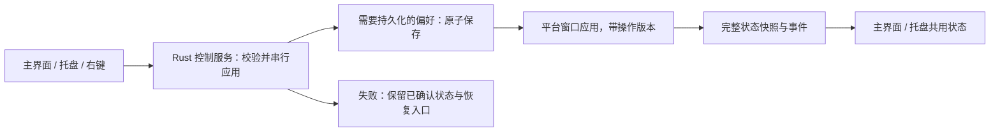

# 首版工程实施说明

基线 `188d46f`；本文件是建议接口与实施任务，不代表接口已存在。产品行为以 [PRD](v0.2-prd.md) 为准，实施验证使用 [验收清单](v0.2-acceptance.md)。

## 1. 先保留现有可靠性边界

继续使用 Tauri + React 和 AppKit / GTK 原生窗口、共享 Playback、IndexedDB v2、原子设置写入和现有串行宠物变更队列。此次不更换状态框架、不引入在线账户、全局快捷键插件、遥测 SDK 或新素材生成服务。

| 当前事实 | 实施影响 |
| --- | --- |
| main.tsx 初始化会自动创建默认宠物 | 引导判断必须移到自动创建之前，否则每次都被误认为老用户 |
| set_frame_root 当前会把 visible 设为 true | 准备素材与显式显示拆开；启动恢复不能覆盖隐藏/休息 |
| visible 已持久化，动画暂停只在会话内 | 新字段必须保留旧设置兼容和这两种语义 |
| 主界面未消费完整原生设置，托盘独立勾选 | 新增统一状态读写与事件，避免维护两套勾选值 |
| LiveStage 播放暂停是本地预览状态 | 保留功能并明确“仅预览”，另接原生暂停开关 |
| macOS 已有单击 happy 和 3pt 拖拽判定 | 抽出统一互动入口，Linux 补齐释放判定 |
| action_revision 用于重播与旧动作过滤 | 新增控制状态 revision，不能混用两种版本号 |
| Windows 当前为 stub | 能力报告为 false，不宣称已有原生桌宠 |

## 2. 状态归属

| 状态 | 唯一来源 | 前端处理 |
| --- | --- | --- |
| 名字、收藏资料、当前选择、引导进度 | IndexedDB | 保持原有事务与跨页变更订阅 |
| 原生显示、动画、自主活动、比例、资源就绪状态 | Rust runtime / 平台渲染确认 | 命令回复和事件更新同一份快照 |
| 隐藏/休息意图、到期时刻、动态偏好 | 原生设置文件 | 不在 localStorage 再存一个桌面版副本 |
| 自启是否成功启用 | 系统自启配置 | 查询并确认后显示，失败保持原值 |
| 当前导航、抽屉、预览逐帧状态 | React | 不改变桌宠 |
| 网页演示状态 | 浏览器演示适配层 | 明确标注，不能伪造原生确认 |

原生控制流程：



## 3. 建议的统一状态契约

新增 `get_native_pet_state`、`update_native_pet_preferences`、`interact_native_pet`。保留旧动作和帧包接口；它们成功变更后也广播统一状态。原生入口直接调用同一服务，不通过 Webview 转发。

下面是拟新增的 TypeScript 数据契约，使用现有 `PetAction` 类型，不是当前已实现接口：

```typescript
type VisibilityMode = "shown" | "hidden" | "snoozed";
type MotionPreference = "system" | "reduce";

interface NativePetState {
  sessionId: string;               // 进程启动生成；重启后更换
  revision: number;                // 当前进程内所有可见控制状态单调递增
  petId: string | null;
  availability: "absent" | "loading" | "ready" | "error";
  visibilityMode: VisibilityMode;  // 用户意图
  snoozeUntilMs: number | null;
  visible: boolean;                // 当前平台实际应用结果
  action: PetAction;
  actionRevision: number;          // 继续保留现有动作版本
  animationPaused: boolean;        // 用户显式暂停，会话内有效
  autonomous: boolean;             // 用户允许自动换姿态的偏好
  motionPreference: MotionPreference;
  systemReducedMotion: boolean | null;
  effectivePaused: boolean;        // 暂停偏好或低动态生效
  effectiveAutonomous: boolean;    // 再考虑暂停、低动态、显示、就绪条件
  scale: number;
  clickThrough: boolean;
  pending: boolean;                // 平台尚未确认当前变更
  autostart: { enabled: boolean; pending: boolean };
  lastOperationError: null | {      // 本会话保留；重新打开主界面仍可恢复
    id: string;
    operation: string;
    code: string;                  // 脱敏错误码；用户文案由界面映射
    recoverable: boolean;
  };
  capabilities: {
    nativeWindow: boolean;
    tapFeedback: boolean;
    clickThrough: boolean;
    resetPosition: boolean;
    autostart: boolean;
    systemReducedMotion: boolean;
  };
}
```

初次获取状态时先订阅事件，再读取快照；缓存初始化期间收到的事件，以 sessionId / revision 合并，防止读取结果覆盖更新事件。Webview 重连或进程会话改变时重新查询，不能用旧进程的 revision 拒绝新快照。

命令和事件共用 `NativePetState`，事件名建议 `native-pet-state-changed`。旧 `native-pet-action-changed` 可在过渡期保留，但前端 reducer 按 actionRevision 去重，不能双重写入 IndexedDB。

新控制命令成功后返回快照；异步窗口应用期间可返回 `pending:true`，应用完毕后广播新 revision 的最终状态。`visible` 只有在平台实际应用后才改变；`availability:ready` 要求当前素材成功替换并可绘制。旧操作的完成回调携带操作版本，发现已被新操作替代时丢弃，不能把新伙伴标成旧伙伴的状态。

`availability` 表达当前已选择伙伴的健康度。切换新伙伴失败、旧伙伴仍然健康时，保持旧 petId 和 ready，另显示操作级错误；不能把旧伙伴误标为素材丢失。

操作级错误随快照提供，保证托盘操作失败后重新打开主界面仍能找到恢复入口。关闭提示只改变界面展开状态；对应操作重试成功后清除错误，无关设置成功不能清除它。错误详情不进入偏好设置文件。

### 3.1 控制意图

`update_native_pet_preferences` 的 request 为判别联合，避免一次传入互相矛盾的显示意图：

| kind | 参数 | 意义 |
| --- | --- | --- |
| show | 无 | shown，清除休息时刻 |
| hide | 无 | hidden，清除休息时刻 |
| snooze | 无 | snoozed，到期 = 原生 now + 3,600,000ms |
| setAnimationPaused | value: boolean | 只改变会话暂停偏好 |
| setAutonomous | value: boolean | 改变并保存自主活动偏好 |
| setScale | value: number | 验证范围 0.5–1.5，保存 |
| setClickThrough | value: boolean | 先检查平台能力，再保存 |
| setMotionPreference | value: system / reduce | 保存动态偏好，重新计算有效状态 |
| setAutostart | value: boolean | 调用系统配置，确认结果 |
| resetPosition | 无 | 调用实际支持的平台能力 |

首次领养、手动“派去桌面”和“保存并入住”是显式 show；后台加载、刷新、资料同步只加载素材。加载与显示分离后，应把这些调用点全部检查一遍。

幂等使用 set 值，不使用 toggle 命令。每个窗口对同一设置串行提交，控件等待时禁用重复提交。Rust 所有入口共用串行控制服务，设置写入失败时回滚本次未确认偏好；不覆盖其他已提交操作。系统自启失败只回滚自启值，不能影响桌宠。

低动态合成：用户显式暂停 `animationPaused` 保持独立；`effectivePaused = animationPaused || reducedMotion`。低动态生效时停止自动换姿态，互动只确认事件、显示文字，不启动动作；保留用户原自主活动和暂停选择，关闭低动态后恢复这些偏好。UI 将低动态影响显示为解释文字，不擅自改掉用户勾选。

桌面版动态偏好信号由原生侧读取，主窗口关闭后也有效。平台不能可靠读取时报告能力 false、systemReducedMotion:null，默认不强制减少，用户仍可手动选择“始终减少”。浏览器用 `prefers-reduced-motion`；它不驱动真实原生状态。

### 3.2 休息和重启

在设置文件新增 `schemaVersion:2`、`visibilityMode`、`snoozeUntilMs`、`motionPreference`。旧 `visible` 继续写入兼容镜像，后续新版以 visibilityMode 为准；镜像仅由状态推导，禁止独立更新。

| 读入情况 | 规范化规则 |
| --- | --- |
| 无新字段，旧 visible=true / false | shown / hidden |
| snoozed 且有效时刻在未来 | 保持，按最近到期时间安排一次唤醒 |
| snoozed 已到期 | 转 shown，清除时刻；资源未就绪前不显示 |
| snoozed 缺失或时刻无效 | 转 hidden，给出可恢复的设置提示 |
| 无伙伴 / 资源错误 | 实际 visible=false；不补建默认角色 |
| 新动态字段不存在 | system |

到期由 Rust 处理，不能由 React 倒计时发送显示命令。应用启动、系统唤醒和时钟变化后重新核对绝对到期时刻；同一休息只执行一次到期转换。过去的时刻立即到期，超出合理时间戳范围的值按无效处理；不可只用阻塞 sleep 等待一小时。

休息/隐藏时停止播放工作和自主调度；唤回增加动作版本，重置到当前动作首帧，避免把隐藏的一小时当作动作经过时间。动画暂停或低动态仍保持有效；自主活动可用时在显示后 5 秒再开始调度。平台 UI tick 可以用于低频检查，但不应隐藏后仍执行每帧解码/绘制。

### 3.3 互动

`interact_native_pet({kind:"pet"|"greet", petId})` 返回 `{accepted, reason, state}`；reason 可为 `cooldown / hidden / paused / not_ready / stale_pet`。冷却使用原生单调时钟，全入口共享；1.5 秒内重复调用不产生动画或错误通知。

ready + shown + 正常动态时，pet 使用 happy、greet 使用 jump，增加现有 actionRevision 并复用 20 秒自主活动冷却。低动态时接受互动并只发可访问文字反馈；显式暂停则返回 paused。失效 petId 不得控制已经切换的新伙伴。

桌面主体释放时区分单击和拖拽。macOS 复用现有 3pt 阈值；Linux 增加按下/移动/释放记录，不在按下时立刻触发反馈。右键和透明区行为保持各平台支持范围。

## 4. 引导与资料兼容

沿用 metadata store，不为新增键升级 IndexedDB 版本；键 `onboarding_v1`，值包含：`state`（in_progress/completed/dismissed）、`step`（choose/name/meet）、`draftName`、`presetId`、`confirmedPetId`（领养提交后存在），以及提交期间的 `adoptionId / pendingPetId / previousActivePetId / phase`（draft/prepared/committed）。

启动顺序：读取引导记录、collection_initialized 和现有集合/旧版 current 记录 → 判断老用户迁移 → 再决定展示引导或恢复当前宠物。已初始化或存在旧宠物、但无引导记录时，写 completed，不创建默认角色；已初始化的空集合同样成立。不能把“旧库有宠物但缺初始化标记”误判成新用户。读取失败展示重试，不按干净安装处理。真正干净安装写 in_progress，原生默认窗口在确认领养前保持未关联/不显示状态，页面使用演示预览。

“领养并入住”采用可恢复的分步提交，不能宣称 IndexedDB 和 Rust 之间存在同一事务：

1. 用一个短 IndexedDB readwrite 事务读取/复用本次 `adoptionId` 和稳定的 `pendingPetId`，保存名字、预设、旧活动 id 与 phase=prepared。多个窗口复用同一份准备记录，不各自生成 id；准备记录写失败时不调用原生。
2. 事务完成后准备素材、串行应用原生替换并等待平台确认。建议扩展现有 `set_native_pet_frame_root` 的操作上下文，携带稳定 petId 和 adoptionId，重复请求复用同一结果；不把 IPC await 放进 IndexedDB 活跃事务。
3. 再开短事务，复核准备记录及活动 id 未被其他操作替代，幂等 put 同一 petId，同时保存活动 id、confirmedPetId、step=meet 与 phase=committed。事务失败恢复原生上一只；没有上一只时隐藏未提交伙伴。回滚也失败时保留错误和准备记录，提供重试，不能显示入住成功。
4. 事务成功后才进入见面；列表刷新失败只重新读取，不能重建。恢复 prepared 记录时复用同一 id，恢复上一次已提交伙伴并提示继续领养，不静默把未提交伙伴当成正式资料。若发现更新的用户切换/删除，以更新意图为准，旧回调不得再次激活草稿。

刷新/重试先读取 confirmedPetId，存在且有效则继续 meet；没有确认 id 时复用准备记录完成同次提交。分别模拟“准备记录后、原生确认后、资料提交后”中断，确保重启可恢复且只产生一条资料。若确认后的宠物被用户主动删除，引导结束并进入空集合，不重建。

新内置角色可使用独立静态清单 `{id, name, description, thumbnail, frameRoot}`。首版只登记现有咕唧；保留 `PetSpecies` 旧值兼容，内置原创角色显示“原创伙伴”，不把旧 dog 值直接当作用户可见物种。后续增加新种类再做专门资料迁移。

## 5. 前端建议拆分

| 文件/组件 | 责任 |
| --- | --- |
| 新 native-pet-client / state reducer | 查询、命令、订阅、session/revision 去重；网页适配 |
| 新 native-pet store 或 hook | 控制状态、pending、错误；使用现有 React 能力 |
| main.tsx | 保留串行宠物激活/删除和恢复协调；逐步抽出引导与控制，不整文件重写 |
| LiveStage.tsx | 展示与回调；分离真实桌宠控制和本地预览工具 |
| 新 Onboarding / PresetGallery | 草稿、领养状态、见面教学 |
| 新 PreferencesDrawer | 能力驱动的设置、焦点管理、状态说明 |
| 新 RecoveryNotice | 持续错误与对应操作；安全详情复制 |
| AppSidebar.tsx / PetShelf.tsx | 使用真实状态标签、空集合入口、名称调整 |
| native_pet/mod.rs | 控制服务、休息时刻、共享互动与统一事件 |
| native_pet/macos.rs / linux.rs | 实际应用确认、单击/拖拽、显示后时钟重置 |
| lib.rs 托盘 | 从同一快照更新，菜单和主界面调用同一服务 |

旧 zoom/autonomous 的 localStorage 只作为网页偏好，桌面版启动不得将它们覆盖原生确认值。新 reducer 不能订阅一次就把所有 state 变化当成“资料改变”写回 IndexedDB；只有与活动宠物一致的动作/资料变更才进入现有队列。

## 6. 分批实施任务

| 批次 | 范围与完成条件 | 主要验证 |
| --- | --- | --- |
| S01 统一状态 | 新快照、控制服务、能力探测、主界面/托盘同源；保留现有 UI | 命令/事件乱序、会话切换、托盘同步、自启失败、旧动作事件 |
| S02 显示与休息 | shown/hidden/snoozed、持久化、到期、隐藏暂停播放、低动态合成 | 假时钟、重启/唤醒、最后一只删除、启动不唤醒、暂停后恢复 |
| S03 领养引导 | 初装/老用户区分，咕唧清单，幂等创建，见面教学 | 干净库、老库、空库、双击、跨页、提交后刷新失败 |
| S04 陪伴界面 | 主页面分层、设置抽屉、互动入口、平台点击、错误恢复 | 两种平台、拖拽误触、冷却、低动态、键盘/小窗口 |
| S05 集成与交付 | 高级制作入口保留、回归/文案/安装体验整理 | 原有 16 流程、AI 取消续传、完整验收、真实桌面操作 |

每批先完成一个可运行闭环，验证、提交并推送；不要等五批全部结束才第一次集成。先做 S01 的查询与状态回显，再接一个真实暂停操作作为最小切片。

## 7. 验证和交付门槛

单元测试覆盖新状态机、迁移、幂等和时钟行为，使用假时钟避免等待一小时；原生接口模拟验证网页，不代替桌面验收。保留已修复的事务、末帧、路径、失败回滚和 AI 取消测试。

使用项目现有 npm / Cargo 命令和锁文件。Rust 测试与既有 tauri dev 使用不同的 CARGO_TARGET_DIR，不停止无关开发服务。安装包按项目已有 Tauri 构建流程制作，不覆盖已有媒体或归档。

对外测试前必须实际确认 macOS / Linux 的显示隐藏、托盘恢复、睡眠唤醒、位置、拖拽和退出；不能把模拟 IPC 的成功标成桌面验收通过。开发告警与依赖升级单独处理，避免和控制状态重构混在一个提交里。

本设计未选择新在线服务，没有需要先申请的账户或付费资源。首版美术使用仓库现有帧，正式新增角色需另行完成素材和来源审查。
